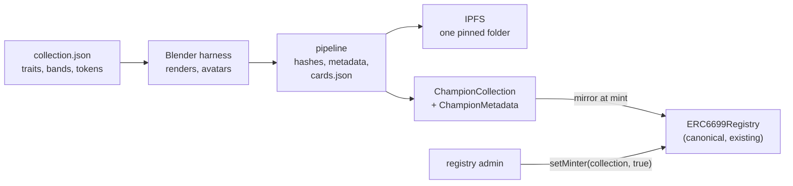

# Step 1: your collection

By the end of this step you have an NFT collection on Liteforge whose tokens are **playable champions**:
- every token is an ERC-721 with ERC-6699 stats;
- its contracts are verified on the explorer;
- every token is mirrored into the canonical ERC6699Registry, where LitNode, Rapture TCG and Rapture Chess find it.

Step 2 sells it (a mint site or packs), and step 3 builds a game around it.

Everything here is in [`packages/collection`](../../packages/collection). Its README is the reference; this page is the
path through it.



## 0. Set up

```bash
git clone https://github.com/strodanodev/rapture-sdk && cd rapture-sdk/packages/collection
pnpm install
pnpm check
```

You need Node 22+, pnpm 12 and Python 3. For your art you also need Blender. `pnpm check` compiles the contracts and
runs every test offline.

## 1. Describe the collection

Copy `examples/starter/` and edit `collection.json`. It decides four things:

- **What a champion is.** Its Kinds (tiers) and the stat band of each, plus up to five named traits: faction,
  alignment, element, frame and kit. It also has up to four body-part slots. Name only the traits you use; a trait
  with an empty label stays out of the metadata.
- **The tokens.** For each one: a name, an optional epithet, its trait values by name, four stats inside its Kind's
  band, and its files. Art is required. Optional files: an avatar GLB, an uncompressed twin of it, a turntable video
  and a SOUL.MD. Per-game `overrides` go in the token's design document.
- **The registry**, per network: the existing ERC6699Registry your tokens mirror into (step 4).
- **Supply.** `setId` and `maxSupply`; token ids are `setId << 32 | index`.

Check it as you go. The pipeline rejects everything the contract would reject (a stat outside its band, an unknown
trait, a name with a character on-chain JSON can't hold) before you spend a transaction:

```bash
node src/cli.js check my/collection.json
```

## 2. Make the art

The Blender harness turns a config into files. Each script runs headless:
`blender --background --python blender/<script>.py -- --config <file>`.

- **Cards:** `render_cards.py` renders one image per token. Give it a card template .blend and bind token fields to
  it: name and epithet to text objects, a trait to which frame object shows, a trait to a material colour, a field to
  an image texture. Without a template it renders a plain built-in card, so you can run the whole path before you
  have art:
  ```bash
  blender --background --python blender/render_cards.py -- --config examples/starter/blender/cards.json
  ```
  Point each token's `art` at its render (`renders.json` lists them). Every image in a collection shares one
  `images.ext`: the starter ships SVG placeholders, so set it to `"png"` (or render WebP) when you switch to renders.
- **Avatars:** `export_avatars.py` turns rigged GLB/FBX characters into game-ready GLBs. It keeps the clips a game
  plays (idle, attack, hit, death), drops helper objects, compresses with Draco and writes an uncompressed twin.
  These are the token's `avatar` and `avatarPlain`.
- **Polish:** `grade.py` re-grades linear renders through Blender's AgX view and looks without re-rendering;
  `key_alpha.py` cuts logos and art off black or green backgrounds; `export_scene.py` exports props or a whole set as
  a web GLB.
- **No modeller?** `tools/meshy_gen.py` generates props from text prompts with Meshy, using your API key and credits.

Rapture's own pipeline is there as configs (`examples/rapture/blender/`), so you can see a real collection's settings.

## 3. Build the metadata and publish the files

```bash
node src/cli.js build my/collection.json --out out
```

This gives you:
- `out/upload/`: every file named by its content hash;
- `out/cards.json`: the mint tuples;
- `out/metadata/`: each token's character.json, exactly as the contract will serve it.

Publish `out/upload/` as one folder:

```bash
PINATA_JWT=... node src/cli.js pin out/upload        # prints ipfs://<CID>/
```

Put that image base in `images.base` and build again. The image base can still change after launch until you
freeze it. The hash each registry twin holds leaves locations out, so moving files never breaks it.

## 4. Choose the registry, and ask for approval

Your collection mirrors into an **existing** registry and never deploys its own. A private registry would make your
champions invisible to LitNode, which reads one registry for the whole fleet. On Liteforge:

| Registry | Address | Its admin |
|---|---|---|
| LitNode's (what nodes read today) | `0x38DF2543e039E775D3f674f7414df43e4eF2f883` | `0x04bE2b954346324Ee54c4B4c0189DF5bb577a378` |
| Rapture's | `0xBeEe6cFAD12346124eb3d51b716fce00B7f11949` | `0x869790B388299FA1E73B8Ad3f188d1f10d4087b5` |

Use the one in `ERC6699RegistryV2` of LitNode's `contracts/deployed.testnet.json`. Forging twins is reserved for
approved minters, so **that registry's admin** must run `setMinter(<your collection>, true)` once. Ask them after you
deploy, giving them your collection's address. You can launch before they do: tokens minted earlier wait as
*MirrorPending*, and one `mirror(ids)` call adds them to the registry later.

## 5. Try it locally

```bash
pnpm run chain                                                                 # terminal 1
pnpm run local-registry --network local
COLLECTION_CONFIG=my/collection.json pnpm run deploy-collection --network local
pnpm run mint-cards --network local
```

The local chain gets a stand-in registry that your deploy approves by itself, so you see mirrored tokens end to end.

## 6. Deploy, verify, mint

With a funded Liteforge key:

```bash
COLLECTION_CONFIG=my/collection.json DEPLOYER_KEY=0x... pnpm run deploy-collection --network liteforge
BLOCKSCOUT_URL=https://<liteforge blockscout> node scripts/verify.mjs liteforge
MINT_TO=0x<wallet> DEPLOYER_KEY=0x... pnpm run mint-cards --network liteforge
```

The deploy script:
- refuses a registry address without a contract;
- writes `deployments/liteforge.json`;
- prints the exact `setMinter` command for the registry admin.

The verify script submits each contract's standard JSON input to Blockscout. It also keeps a copy in
`verification/liteforge/` for a manual upload.

## 7. Check it

- **Explorer:** each contract shows as verified, and `tokenURI` decodes to the JSON in `out/metadata/`.
- **Registry:** `registry.manifestOf(collection.registryIdOf(id))` names the holder as `agentController`.
  Its `characterConfigHash` matches `out/manifest.json`.
- **Collection:** `collection.pendingMirrors()` is 0.

## Next

Step 2 sells your champions. The collection already speaks the minting ABI that Rapture's PackShop and the SDK's
fixed-price minter call, so you grant a minter with `collection.setMinter(<minter>, true)` and nothing else changes.
