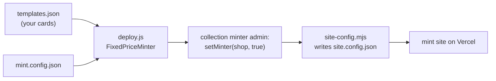

# Step 2: from a deployed collection to a live mint site

Step 1 left you with a collection on LitVM: an ERC-721 whose minter mints finished cards, and the cards themselves
(each one's kind, traits, stats and design record). This step sells them at a fixed price. You deploy a minter next to
the collection, the collection's admin lets it mint, and a static site on Vercel lets people buy.



You need Node 22+, pnpm, a wallet funded with zkLTC on Liteforge (chain 4441, RPC
`https://rpc.testnet.liteforge.zeeve.net/`) to deploy from, and the key of the collection minter's admin, or that
admin's cooperation (one transaction). A Safe to own the shop is recommended. The two folders are
[`packages/mint`](../../packages/mint) (contracts and scripts) and [`apps/mint-site`](../../apps/mint-site) (the site).

**FixedPriceMinter** sells a catalogue: a buyer picks a card and pays per copy, each card has an edition size, and the
cards are minted in the same transaction. A pack option exists too (sealed packs from a fixed print run, with drand
randomness), but it isn't published in this kit yet: it stays in Rapture's private build until Rapture launches it.

## 1. Write the mint config

```bash
cd packages/mint
pnpm install
mkdir my-drop && cp examples/fixed/mint.config.json my-drop/
```

Set `collection.minter` (your collection's minter), `collection.cards` (the ERC-721) and `collection.tokenIdBase`
(the first token id of your set: `setId << 32` for a collection made with step 1, e.g. `4294967296` for set 1). Set
the price, the edition size (`fixed.supply`, or a `supply` on each template) and a per-wallet limit. Set `owner` to
your Safe.

Then the templates: one entry per card you sell, in the order the shop should hold them. If your cards are already
minted (step 1 mints them), read them back from chain:

```bash
node scripts/export-templates.mjs --config my-drop/mint.config.json --from 4294967296 --count 50
```

Check everything offline. It names every problem: a trait out of range, a kit on the wrong kind, a name with a
character the collection refuses.

```bash
pnpm run check-config my-drop/mint.config.json
```

## 2. Rehearse on your own machine

The same config runs against a local Hardhat chain. There, the deploy script sends without asking, and because your
collection is not on the local chain it deploys the reference collection to sell instead.

```bash
pnpm run node                                                          # terminal 1
MINT_CONFIG=my-drop/mint.config.json pnpm run deploy:local             # terminal 2
node scripts/verify.mjs --config my-drop/mint.config.json --network local
```

Then look at the site against it: in `apps/mint-site`, copy `web/site.config.json` to `web/site.config.local.json`,
run `node scripts/site-config.mjs --config my-drop/mint.config.json --network local --site
../../apps/mint-site/web/site.config.local.json` from `packages/mint`, and `pnpm dev` in `apps/mint-site`. Add the
local chain to MetaMask (`http://127.0.0.1:8547`, chain 31338) with one of Hardhat's public test accounts, mint a card,
and find it under "My cards".

## 3. Deploy on Liteforge

The dry run is read-only. It prints the plan, the signer's balance and the collection minter's admin.

```bash
MINT_CONFIG=my-drop/mint.config.json DEPLOYER_KEY=0x… pnpm run deploy:liteforge
```

Then for real:

```bash
MINT_CONFIRM=liteforge MINT_CONFIG=my-drop/mint.config.json DEPLOYER_KEY=0x… pnpm run deploy:liteforge
```

It deploys the shop, loads the templates, and then:

- **The MINTER role.** If the signer is the collection minter's admin, it grants the role itself. If not, it stops
  before opening sales and prints the one call the admin must make, `setMinter(<shop>, true)` on the collection
  minter (from a Safe: the Transaction Builder, with the minter's ABI). Re-run the deploy afterwards; it carries on
  where it stopped.
- **Preflight and lock.** A preflight proves every template mints on your collection (static calls, nothing sent), then
  `lock()` freezes the catalogue and edition sizes.
- It opens sales, then offers ownership to `owner`. Accept it from the Safe: `acceptOwnership()` on the shop.

The addresses land in `my-drop/deployments/liteforge.json`. Commit that file: it is public, and the other scripts read
it.

## 4. Verify the source

```bash
pnpm compile
node scripts/verify.mjs --config my-drop/mint.config.json
```

This proves the code on chain is exactly this build and writes the explorer package to `verification/liteforge/`.
To publish the source on the explorer, add `EXPLORER_URL=https://<the Liteforge Blockscout> VERIFY_CONFIRM=liteforge`.
(The old Caldera explorer is gone; `scripts/lib/networks.json` has `explorer: null` until the new one is known.)

## 5. Make the site yours

```bash
cd ../../apps/mint-site
pnpm install
node ../../packages/mint/scripts/site-config.mjs --config ../../packages/mint/my-drop/mint.config.json --site web/site.config.json
```

`site-config` checks the shop on chain (code, MINTER role, templates in order) and writes the `chain`, `mint` and
`cards` sections. Then edit the rest of `web/site.config.json`: the name, tagline and description, `branding.colors`,
the kind names. Put your logo and art in `web/art/` (card art 5:7) and point `branding` and `art` at it;
`pnpm placeholder-art` redraws the plain placeholders if you want them back.

```bash
pnpm csp          # vercel.json's Content-Security-Policy for this config
pnpm run check    # config, art paths, CSP, the pages, the tests
pnpm dev          # http://localhost:5180 against Liteforge: connect a wallet and buy one
```

## 6. Go live on Vercel

```bash
vercel link && vercel deploy        # a preview URL: check every page with the console open
vercel deploy --prod
```

[`apps/mint-site/DEPLOY.md`](../../apps/mint-site/DEPLOY.md) covers Git deploys, your own domain and what to check
after. The site has no server and no secrets; the strict CSP allows only the site itself, the RPC and an IPFS gateway
if you set one.

Rapture's own site, forge.litvm.games, sells the live Rapture collection on Liteforge (StudioMinter `0x52Ad…3b94`,
RaptureCards `0x138F…2721`, token ids from `4294967296`); this template is its shop with the 3D hall and Rapture's art
taken out.

## Checklist

- [ ] `check-config` passes, and the rehearsal on the local chain minted and the library showed the cards
- [ ] the shop is deployed, stocked, locked, verified, holds MINTER, and sales are open
- [ ] the Safe accepted ownership (`owner()` is the Safe)
- [ ] the site config points at the shop, `pnpm run check` passes, and the deployed site shows no CSP errors
- [ ] you bought one card on the live site with a fresh wallet and found it under "My cards"
