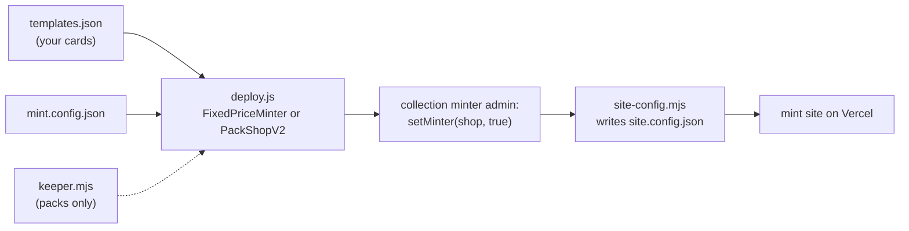

# Step 2: from a deployed collection to a live mint site

Step 1 left you with a collection on LitVM: an ERC-721 whose minter mints finished cards, and the cards themselves
(each one's kind, traits, stats and design record). This step sells them. You deploy a minter next to the collection,
the collection's admin lets it mint, and a static site on Vercel lets people buy.



You need Node 22+, pnpm, a wallet funded with zkLTC on Liteforge (chain 4441, RPC
`https://rpc.testnet.liteforge.zeeve.net/`) to deploy from, and the key of the collection minter's admin, or that
admin's cooperation (one transaction). A Safe to own the shop is recommended. The two folders are
[`packages/mint`](../../packages/mint) (contracts and scripts) and [`apps/mint-site`](../../apps/mint-site) (the site).

## 1. Choose how you sell

| | Fixed price (default) | Packs |
|---|---|---|
| Contract | FixedPriceMinter | PackShopV2 |
| The buyer | picks a card and pays per copy | buys a sealed pack, opens it ~15 s later |
| Supply | an edition size per card | a print run: an exact count per kind and finish (Normal, Shiny, Gold) |
| Randomness | none | drand, verified on chain |
| Runs beside it | nothing | a keeper (any small always-on machine) |
| Transactions per buy | 1 | 2 (buy, then open) |

Fixed price is simpler to run and to explain. Packs make a game of the drop: rarity, finishes and a reveal, with
pulls nobody can steer, not even you.

## 2. Write the mint config

```bash
cd packages/mint
pnpm install
mkdir my-drop && cp examples/fixed/mint.config.json my-drop/      # or examples/packs/ (copy its deck.json too)
```

Set `collection.minter` (your collection's minter), `collection.cards` (the ERC-721) and `collection.tokenIdBase`
(the first token id of your set: `setId << 32` for a collection made with step 1, e.g. `4294967296` for set 1). Set
the price, and for fixed price the edition size (`fixed.supply`, or a `supply` on each template) and a per-wallet limit;
for packs the pack size, the daily limit and the deck. Set `owner` to your Safe.

Then the templates: one entry per card you sell, in the order the shop should hold them. If your cards are already
minted (step 1 mints them), read them back from chain:

```bash
node scripts/export-templates.mjs --config my-drop/mint.config.json --from 4294967296 --count 50
```

Check everything offline. It names every problem: a trait out of range, a kit on the wrong kind, a name with a
character the collection refuses, a deck with cards of a kind that has no template.

```bash
pnpm run check-config my-drop/mint.config.json
```

## 3. Rehearse on your own machine

The same config runs against a local Hardhat chain. There, the deploy script sends without asking, and because your
collection is not on the local chain it deploys the reference collection to sell instead.

```bash
pnpm run node                                                          # terminal 1
MINT_CONFIG=my-drop/mint.config.json pnpm run deploy:local             # terminal 2
node scripts/verify.mjs --config my-drop/mint.config.json --network local
node scripts/keeper.mjs --config my-drop/mint.config.json --network local    # packs only
```

Then look at the site against it: in `apps/mint-site`, copy `web/site.config.json` to `web/site.config.local.json`,
run `node scripts/site-config.mjs --config my-drop/mint.config.json --network local --site
../../apps/mint-site/web/site.config.local.json` from `packages/mint`, and `pnpm dev` in `apps/mint-site`. Add the
local chain to MetaMask (`http://127.0.0.1:8547`, chain 31338) with one of Hardhat's public test accounts, then mint,
or buy and open a pack, and find the cards under "My cards".

## 4. Deploy on Liteforge

The dry run is read-only. It prints the plan, the signer's balance and the collection minter's admin and, for packs,
proves that Liteforge verifies a live drand signature.

```bash
MINT_CONFIG=my-drop/mint.config.json DEPLOYER_KEY=0x… pnpm run deploy:liteforge
```

Then for real:

```bash
MINT_CONFIRM=liteforge MINT_CONFIG=my-drop/mint.config.json DEPLOYER_KEY=0x… pnpm run deploy:liteforge
```

It deploys the shop (packs: and the drand verifier), loads the templates, and then:

- **The MINTER role.** If the signer is the collection minter's admin, it grants the role itself. If not, it stops
  before opening sales and prints the one call the admin must make, `setMinter(<shop>, true)` on the collection
  minter (from a Safe: the Transaction Builder, with the minter's ABI). Re-run the deploy afterwards; it carries on
  where it stopped.
- **Fixed price:** a preflight proves every template mints on your collection (static calls, nothing sent), then
  `lock()` freezes the catalogue and edition sizes.
- **Packs:** `setDeck` and `lock()` fix the print run for good.
- It opens sales, then offers ownership to `owner`. Accept it from the Safe: `acceptOwnership()` on the shop.

The addresses land in `my-drop/deployments/liteforge.json`. Commit that file: it is public, and the other scripts read
it.

## 5. Verify the source

```bash
pnpm compile
node scripts/verify.mjs --config my-drop/mint.config.json
```

This proves the code on chain is exactly this build and writes the explorer package to `verification/liteforge/`.
To publish the source on the explorer, add `EXPLORER_URL=https://<the Liteforge Blockscout> VERIFY_CONFIRM=liteforge`.
(The old Caldera explorer is gone; `scripts/lib/networks.json` has `explorer: null` until the new one is known.)

## 6. Start the keeper (packs)

```bash
KEEPER_KEY=0x… node scripts/keeper.mjs --config my-drop/mint.config.json
```

Any funded wallet works: dealing is permissionless and costs ~0.3M gas per drand round. It fixes each pack's cards
seconds after its round is published, and covers the one trust gap PackShopV2 has, a chain clock that lags real
time. Keep it running for as long as the shop sells, and after a `shutdown()`.

## 7. Make the site yours

```bash
cd ../../apps/mint-site
pnpm install
node ../../packages/mint/scripts/site-config.mjs --config ../../packages/mint/my-drop/mint.config.json --site web/site.config.json
```

`site-config` checks the shop on chain (code, MINTER role, templates in order, the locked deck and beacon for packs)
and writes the `chain`, `mint` and `cards` sections. Then edit the rest of `web/site.config.json`: the name, tagline and
description, `branding.colors`, the kind and finish names. Put your logo and art in `web/art/` (card art 5:7) and point
`branding` and `art` at it; `pnpm placeholder-art` redraws the plain placeholders if you want them back.

```bash
pnpm csp          # vercel.json's Content-Security-Policy for this config
pnpm run check    # config, art paths, CSP, the pages, the tests
pnpm dev          # http://localhost:5180 against Liteforge: connect a wallet and buy one
```

## 8. Go live on Vercel

```bash
vercel link && vercel deploy        # a preview URL: check every page with the console open
vercel deploy --prod
```

[`apps/mint-site/DEPLOY.md`](../../apps/mint-site/DEPLOY.md) covers Git deploys, your own domain and what to check
after. The site has no server and no secrets; the strict CSP allows only the site itself, the RPC, the drand mirrors
(packs) and an IPFS gateway if you set one.

## Rapture, the worked example

Rapture's ARC 1 drop is [`packages/mint/examples/rapture`](../../packages/mint/examples/rapture) by reference: the
live Liteforge collection (StudioMinter `0x52Ad…3b94`, RaptureCards `0x138F…2721`, token ids from `4294967296`) and the
888-card ARC 1 deck (177 packs of 5 plus a 3-card reserve; 27 Gold cards in all). Its 50 templates are read from chain
with `export-templates`, not shipped. forge.litvm.games is Rapture's own site on the same contracts; this template is
that site's shop with the 3D hall and Rapture's art taken out.

## Checklist

- [ ] `check-config` passes, and the rehearsal on the local chain minted (or opened) and the library showed the cards
- [ ] the shop is deployed, stocked, locked, verified, holds MINTER, and sales are open
- [ ] the Safe accepted ownership (`owner()` is the Safe)
- [ ] packs: the keeper runs, and the dry run confirmed drand verification on Liteforge
- [ ] the site config points at the shop, `pnpm run check` passes, and the deployed site shows no CSP errors
- [ ] you bought one card (or pack) on the live site with a fresh wallet and found it under "My cards"
