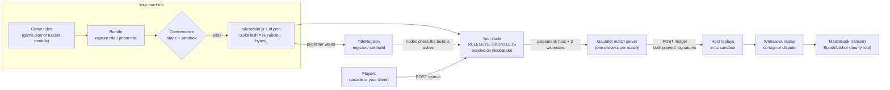

# Step 4: take your game to LitNode

[LitNode](https://github.com/strodanodev/litnode) is the open (Apache-2.0) node software of the litVM Games mesh.
A title on LitNode is one JavaScript file, pinned on chain by its hash. Bonded nodes host it, and an independent
witness on another operator's machine replays each match before the result lands on the shared ladder.

This page takes a game made with the kit ([03-game.md](03-game.md), the card game or the board game) down the
**replayable** path. In that path, the node re-runs every match from the signed input log, so no key of yours
decides a result. If your game can't be replayed (float physics, a closed engine), use the **attested** path in
[05-bring-your-game.md](05-bring-your-game.md) instead.

Checked against LitNode **0.12.1** (protocol 4) and the Liteforge testnet (chain 4441) on 2026-11-13. Rapture TCG
and Rapture Chess are the worked examples.



## Which steps need your keys

| Step | Key | Whose |
|---|---|---|
| Conformance, bundle, buildHash | none | — |
| `register`, `set-build`, `revoke`, `transfer` on TitleRegistry | `PUBLISHER_KEY` (an EVM wallet with zkLTC for gas) | **yours**: the wallet that will hold the title |
| Bond the node (`npm run host -- bond`), delegate its announcer | `OPERATOR_KEY` (an EVM wallet with 1 tLITVM to stake, plus gas) | **yours**: use the **same wallet** as the title, or the arcade won't list the title |
| The node's own identity | `DATA_DIR/identity.json` (ed25519, made by `npm run host -- init`) | the node; back it up, never share it |
| A relay key, so a match the loser never signs still settles (`RELAY_KEYS`) | ed25519, made by the board template's `pnpm relay-key` | yours; not a wallet |
| Queue, seat, sign the match end | the player's ed25519 key, held by the arcade shell or your client | the players' |

Keys go in the shell for one command and nowhere else. Never put one in `node.env`, a config file or this repo.
Nothing on this page needs a key until "Register the title".

## 0. Before you start

```bash
git clone https://github.com/strodanodev/litnode ../litnode
cd ../litnode && npm install && cd -
```

Put the LitNode checkout somewhere permanent: where it sits can change your buildHash (see "Why a buildHash
changes when the rules don't" below).

**The RPC.** Liteforge's working endpoint is `https://rpc.testnet.liteforge.zeeve.net/`. The old Caldera endpoint is
dead (HTTP 404). LitNode 0.12.1 still ships Caldera as `rpc` in `contracts/deployed.testnet.json`:

- **The node** takes `RPC=https://rpc.testnet.liteforge.zeeve.net/` (or `npm run host -- init … --rpc <url>`).
- **The wallet tools** (`publish:title`, `bond`, `delegate`, `announcer`) read only that file. Either change `rpc`
  in your local copy of `contracts/deployed.testnet.json` to the Zeeve URL, or use `--calldata`, which needs no RPC
  and no key, and send the printed transaction from your wallet.

## 1. Conformance

Every node runs the same suite (`sdk/conformance.mjs`) inside `installRuleset` before it loads a build. Run it
first, because a build that fails it never loads anywhere.

- **STATIC** reads the text and executes nothing. The file must be one ES module with no imports and a default
  export. A purity lint flags `Math.random`, `Date`, `fetch`, timers and storage.
- **SANDBOX** runs the title in a separate `node --permission` process with an empty environment, a heap ceiling and
  a deadline. Inside it there is no `Date`, `Intl`, `Math.random`, `process`, `fetch` or `require`. It checks the
  manifest, `init`/`step`/`done`/`serialize`/`view`/`scores`, and replays seeded inputs twice to the same
  `serialize()` root.
- A missing `display` block is a warning: the node hosts the title, but the arcade won't list it.

The kit's game templates are written to pass. Your job is to keep your rules inside the same limits: all randomness
from the seed (`seededRandom`), integer or fixed-point math, and no wall clock.

## 2. Bundle the ruleset

### The card game (`@rapture-sdk/tcg`)

```bash
pnpm exec rapture title games/my-game.game.json --out rulesets --litnode ../litnode
```

It writes `rulesets/<rulesetId>.js` (the artifact) and `rulesets/<rulesetId>.json` (the sidecar a node reads), and
prints the buildHash and the `register` call. The `rulesetId` comes from `litnode.rulesetId` in your game file.
`--litnode <dir>` (or `LITNODE_HOME`) runs that checkout's real conformance suite and must end with
`conformant — a bonded node will host it`. Without it, `rapture title` runs a built-in copy of the checks, which is
fine while you iterate but isn't the gate.

Projects still installed from the frozen Tessaract repo call the same command `tessaract title`. Rapture TCG's
`pnpm title` is `tessaract title games/rapture-duel.game.json`.

### The board game (`@rapture-sdk/board`)

```bash
pnpm title                       # LITNODE_DIR=../LITNODE/litnode by default
```

This is Rapture Chess's two-pass builder (`scripts/build-title.mjs`):

1. esbuild inlines your ruleset module and its dependencies into one import-free file, `titles/<rulesetId>.mjs`.
2. LitNode's own `tools/bundle-title.mjs` takes that file. It runs from inside the LitNode checkout, runs the
   conformance suite on the result, and writes `rulesets/<rulesetId>.js` and `.json`.

### Any title, by hand

```bash
cd ../litnode
npm run conformance -- titles/my-title.v1.mjs
npm run bundle:title -- titles/my-title.v1.mjs      # rulesets/my-title.v1.js + .json { buildHash }
```

### The buildHash

`buildHash = sha256("ruleset" + NUL + <the exact bytes of rulesets/<id>.js>)`, LitNode's `H('ruleset', bytes)`.
Nodes advertise it, fetch builds from each other by it, and refuse a body that doesn't hash to it. Every replayable
submission carries it.

- Keep the `.js` and the `.json` together, and commit both.
- Line endings are bytes. Commit rulesets as `-text` in `.gitattributes` (22 GODS does:
  `litnode/rulesets/*.js -text`), so a Windows checkout with `autocrlf` can't change the hash.
- No minify: the artifact stays readable on purpose, because it is the audit trail of what settled.

### Why a buildHash changes when the rules don't

esbuild writes a comment with each inlined module's path into the bundle, **relative to the working folder of the
build**:

```js
// ../my.game.json
// ../../../../Documents/LitVM Games/theforge/sdk/packages/tcg/src/core/effects.ts
```

So the same rules built from another folder are different bytes and a different buildHash. We built the kit's
starter game twice with nothing changed but the working folder: `60776b99…` and `78c981ca…`. The 9 lines that
differ are all path comments. Built again from the first folder, it gave `60776b99…` again. Real artifacts show
the same thing:

- Rapture TCG's `rapture-duel.v4.js` carries the pnpm store path of its SDK install
  (`node_modules/.pnpm/tessaract@https+++codeload._d9d1…/…`). Moving the game from the frozen Tessaract install to
  `@rapture-sdk/tcg` changes the hash even if no rule moves.
- Rapture Chess's second pass runs inside the LitNode checkout, so `rapture-chess.v2.js` opens with
  `// ../../CHESS/titles/rapture-chess.v2.mjs`: the game's path as seen from LitNode. Moving either checkout moves
  the hash.

The rules that follow:

1. **Rebuild a title from the same install path**: the same project folder, the same working folder, the same
   LitNode folder (for the board builder) and the same SDK install source. Better still, don't rebuild a registered
   build at all. Commit the artifact and serve the committed bytes, as Rapture Chess keeps `rapture-chess.v1.js`
   pinned while v2 is current.
2. **Any rules change gets a new `rulesetId`** (`my-game.v1` → `my-game.v2`). LitNode would accept a rules change
   as a new build under the old id (`set-build`), but ladders, stats and Elo fold per `rulesetId`, so mixing two
   rule sets under one id mixes their results. Rapture Chess went from v1 to v2 when it added the clock and draw
   offers.
3. **A byte-only change** (a moved folder, a new SDK install, same rules) is a new build under the **same** id:
   `set-build` it before your node serves it. Old matches stay replayable under the build they settled with, on
   any node that kept those bytes.

## 3. Register the title (your publisher wallet)

TitleRegistry on Liteforge is `0x4A0de8EB216CC4445A767ed25c4f154d0f904489`. A title is an ERC-721 whose holder is
the publisher, with `tokenId = keccak256(rulesetId)`, first come, first served. Nodes load a build from a peer
only when the chain says it is registered under its title and active.

From the LitNode checkout, with the publisher wallet's key in the shell for these commands only:

```bash
cd ../litnode
export PUBLISHER_KEY=0x...                                   # PowerShell: $env:PUBLISHER_KEY = '0x...'
npm run publish:title -- register  ../my-game/rulesets/my-game.v1.js
npm run publish:title -- status    ../my-game/rulesets/my-game.v1.js
unset PUBLISHER_KEY                                          # PowerShell: Remove-Item Env:PUBLISHER_KEY
```

| Command | Contract call | Notes |
|---|---|---|
| `register <file>` | `register(string rulesetId, bytes32 buildHash)` | Claims the id. The first build is active at once. |
| `set-build <file> [--activates <ISO time>]` | `setBuild(uint256 titleId, bytes32 buildHash, uint64 activatesAt)` | A new build. Active no earlier than 60 s after it's mined (`activationDelay`); peers refuse it until then. |
| `revoke <file>` | `revokeBuild(uint256 titleId, bytes32 buildHash)` | Immediate. |
| `transfer <file> <to>` | ERC-721 `transferFrom` | The token is the publisher; any wallet UI can do it too. |
| `status <file>` | read-only | Shows the publisher and each build `active`, `pending` or `REVOKED`. |

Add `--calldata` to `register`, `set-build`, `revoke` or `transfer` to print the transaction instead of sending
it. Use it for a multisig or a browser wallet, and while the tool's RPC still points at Caldera. With MetaMask:

- Plain Send drops the hex data, so use a wallet that sends calldata.
- On Liteforge, set the max fee to at least twice the base fee, or the RPC can refuse the transaction before it's
  mined.

What we learned claiming titles (LitNode `docs/HOST-YOUR-TITLE.md`):

- **Claim early.** Do it as soon as the `rulesetId` is final and the bundle passes. Until you claim, no other node
  loads your build from a peer, so nobody can witness your matches.
- **Claim from the wallet that bonds your host.** The arcade lists a title only while a bonded node, bonded from
  the wallet that holds the token, hosts it.
- **Register the exact file your node loads**, the one named in `RULESETS`.

State on 2026-11-13: `rapture-chess.v1` is registered with one active build (`cf604358…`).
`rapture-chess.v2` and `rapture-duel.v4` aren't registered yet. A new `rulesetId` is a new title, so v2 needs its
own `register`.

## 4. Host it on a node

A title nobody hosts on a bonded node is never placed. Run your own host (LitNode's `npm run host` harness wraps
the daemon; `docs/HOST-A-NODE.md` and `docs/OPERATORS.md` cover all of it):

```bash
cd ../litnode
npm run host -- init --operator my-studio-node \
  --rpc https://rpc.testnet.liteforge.zeeve.net/ \
  --rulesets "C:/games/my-game/rulesets/my-game.v1.js" \
  --gauntlets "my-game.v1=C:/games/my-game/gauntlet.json" \
  --gauntlet-gateway-port 8478 \
  --relay-keys <relay public key> \
  --tunnel quick
npm run host -- doctor
npm run host -- start --detach
OPERATOR_KEY=0x... npm run host -- bond          # stakes 1 tLITVM from the publisher wallet
OPERATOR_KEY=0x... npm run host -- publish       # tunnel up, /whoami proof, announcer delegated and funded
npm run host -- verify                           # exit 0 only when every required stage is done
```

The same settings as `node.env` lines (the LitNode Control Plane rewrites `node.env` from user environment
variables, so set them there when you use it):

```ini
RPC=https://rpc.testnet.liteforge.zeeve.net/
RULESETS=C:/games/my-game/rulesets/my-game.v1.js
GAUNTLETS=my-game.v1=C:/games/my-game/gauntlet.json
GAUNTLET_GATEWAY_PORT=8478
RELAY_KEYS=<relay public key>
```

- **`RULESETS`**: comma-separated paths to the artifacts. Old builds a node already holds are kept automatically.
- **`GAUNTLETS=<rulesetId>=<config.json>`**: the match server the node spawns for each match it hosts. Copy
  the template's config: `templates/gauntlet.json` for the card game (set `cwd` and `TCG_GAME`), or
  `gauntlets/rapture-chess.json` for the board game. `cwd` is your game checkout with `pnpm install` done. The
  node spawns `command` and `args` there on a free port from `portRange` and kills it `settledGraceMs` after the
  match settles, or at `ttlMs`.
- **Environment for the match server.** Since LitNode 0.12.0, a match server inherits only the OS basics (`PATH`,
  `TEMP`, `HOME` and the like), never the operator's environment. Any other variable it reads (`TCG_RPC`,
  `TCG_STATS_CONTRACT`, …) goes in the config's `env`, or by name in `inheritEnv`. The node adds the match itself:
  `GAUNTLET_MATCH_ID`, `GAUNTLET_ROOM`, `GAUNTLET_PORT`, `GAUNTLET_SECRET`, `GAUNTLET_SEATS`,
  `GAUNTLET_PUBLIC_URL`, `GAUNTLET_NODE_URL`, `GAUNTLET_MODE`, `GAUNTLET_PLACED_MODE`, `GAUNTLET_SEED`,
  `GAUNTLET_BUILD` and `GAUNTLET_RULESET`.
- **`GAUNTLET_GATEWAY_PORT`** is needed when the node already fronts another title's relay on `RELAY_PORT`.
  Otherwise `RELAY_PORT` alone is the gateway.
- **A public `https://` address.** Browsers reach your match at `wss://<wsAddr>/<room>`, so the node needs a tunnel
  (`TUNNEL=quick`, or `named` for a stable hostname) or its own public address.
- **The client** must allow the arcade to frame it. Production `frame-ancestors` must include
  `arcade.litvm.games`, and `connect-src` must include the node's `wss://` host.

Check it: within a minute, `GET https://<your node>/titles` shows your title with `owner` and `published: true`.
LitNode 0.12.1's arcade lists any published title that has a `display` block, with no LitNode release needed.

## 5. Match placement

1. **Queue.** The player's key signs a queue entry (`POST /queue`:
   `{playerId, rulesetId, mode, bucket, tokenId?, region?}`). Inside the arcade the shell signs it; outside, your
   client does it with LitNode's `sdk/client.js`.
2. **Place.** Nodes pair players by ruleset and mode, then freeze a placement (`GET /match`): the participants,
   ruleset, build, mode, seed `H(beacon, matchId)` from a Liteforge block, the host, and a panel of three witnesses
   drawn by stake from bonded nodes under other operators. The descriptor is signed, and the submission must match
   it later.
3. **Commit (ranked).** For a ranked, placed match, the host commits it on MatchBook before play:
   `commit(matchId, descriptorHash, rulesetId, hostKey, panel[3])`.
4. **Seat.** The arcade opens your `display.url` in an iframe with `?ws&room&player&match&build`. The client asks
   `GET <ws>/<room>/ticket?player=<key>`, signs the one-time challenge (`cabinet:sign-seat` inside the arcade),
   gets an HMAC seat ticket, and joins `wss://<wsAddr>/<room>`. Match ids and participants are public, so naming a
   placed player is never enough: the key must sign.
5. **Play.** Your match server orders the log, one entry per tick: `{k, inputs: [side0, side1]}`, hash-chained from
   `'genesis'`.

**Ranked needs four operators.** Only a host with three witnesses under three other operators commits on chain.
With fewer bonded operators carrying your title, matches play as casual (unplaced, or with the commit skipped).
They settle and rank on the `scope=all` ladder, but they are never official.

## 6. Witness replay

At the end, each player signs `{matchId, ticks, head, buildHash}` under the `ledger` tag (`cabinet:sign` in the
arcade). The match server posts the ledger to the node on loopback:

```json
{ "matchId": "…", "rulesetId": "my-game.v1", "buildHash": "<64 hex>", "mode": "ranked",
  "participants": ["<key>", "<key>"], "entries": [{ "k": 0, "inputs": [ … ] }],
  "signatures": { "<key>": "<sig>" }, "descriptor": { … }, "hydration": { … } }
```

Then:

- **The host replays** the log in its sandbox from the seed and computes the delta and its `resultHash`. The hash
  commits to the build, the descriptor, the participants, the final state root, the hydrated characters, the
  scores, the proof level and the stats.
- **Each witness replays independently** and signs only `{matchId, resultHash}` (`POST /cosign`). A witness that
  reaches a different result files a signed dispute naming the fields that differ (`POST /dispute`), and the match
  escalates.
- **Off-chain results get custody too.** A casual result is advertised on gossip, and three custodian nodes, drawn
  from the hash of the match id, fetch the delta and the ledger, recompute, and co-sign or dispute.

The proof level is derived by the node and never upgraded:

| Level | `proof` | What backs it | Official |
|---|---|---|---|
| L3 | `verified` | a log both players signed, replayed by witnesses | yes, once ranked, placed, witnessed and undisputed |
| L2 | `checkable` | a log signed by your relay key (`RELAY_KEYS`), re-runnable by anyone | no |
| L1 | `attested` | a court's signed report ([05-bring-your-game.md](05-bring-your-game.md)) | no |
| L0 | `host` | an unsigned casual submission, one node's word | no |

The board template's relay asks both players for their signatures. If one leaves or won't sign, it posts under its
own relay key (`relay`, L2), and for casual matches only, unsigned as a last resort (`host`, L0).

## 7. Settlement

For a placed, ranked match, each step goes out from the node's delegated key (MatchBook
`0x90D642d1f1Cb00EBFeB2268dd13Dee32A2852e5b`):

1. `settle(matchId, resultHash, ledgerHash, buildHash, participants, scores, custodians)` from the host;
2. `attest(matchId, witnessKey, resultHash)` from each witness after its replay;
3. `finalize(matchId)` by the host, or by a witness as the liveness backstop;
4. on a dissent, `escalate`, a nine-seat draw, `resolve`, and slashing through NodeStake;
5. `GasRefund.claim` by the host and the agreeing witnesses;
6. every hour, the settler proposes the Merkle root of the hour's deltas to EpochAnchor, final at stake quorum.

Nothing is minted per match. Elo, credits, stats and progression are folds every node computes the same way from
the deltas, and the node serves them at `/leaderboard?ruleset=<id>` (official only; add `&scope=all` for every
settled match), `/credits`, `/stats`, `/progress` and `/proof/<matchId>`.

A result is **official** only when all of these hold: both players signed, the mesh placed it as ranked, an
independent bonded witness reached the same commitment, and nobody disputes it.

LitNode has no fees, stakes or payouts. If your game wants a wager, the escrow is yours, paid out from the node's
signed delta, as Rapture Chess's `LitNodeWager.sol` does.

## 8. Champions: the ERC-6699 registry the node reads

For a ranked match, the node reads each player's character from an **ERC6699Registry** at the placement's block,
never from the submission:

- it reads `coreStats(tokenId)` and `manifestOf(tokenId)`;
- it checks that the player key's PlayerProfile owner owns or controls the token;
- it strips equipment ("sterile" ranked);
- it passes the result to your title as `ctx.agents`.

The hydration manifest is hashed into the result, so a witness that reads a different character reaches a
different result. ERC-6699 is this project's **proposed** interface. No ERC number is assigned, so don't call it a
standard.

**Which registry.** The node uses `ERC6699` from its environment, or else `ERC6699RegistryV2` from
`contracts/deployed.testnet.json` (`node/cli.mjs`). In 0.12.1 that is LitNode's registry
`0x38DF2543e039E775D3f674f7414df43e4eF2f883`.

**The Rapture mismatch.** Rapture's collection deploy script deployed a fresh registry,
`0xBeEe6cFAD12346124eb3d51b716fce00B7f11949`, and passed it to RaptureCards
(`0x138F1A2E48111aFD0Af865F421F05Fd1B0A72721`) as an immutable constructor argument. So every Rapture card mirrors
into `0xBeEe…` and none into `0x38DF…`. On chain, `0x38DF…` holds 0 characters and `0xBeEe…` holds 9,735, one per
card, each controlled by the card's holder.

Each mirrored card has its own id in the registry, its **twin id**:
`registryIdOf(tokenId) = uint256(keccak256(abi.encode(RaptureCards, tokenId)))`. A client queues with the twin id,
not the card's token id.

The fixes, best first:

1. **Point LitNode at `0xBeEe…`** in a LitNode release (`ERC6699RegistryV2` in `deployed.testnet.json`).
   **Recommended.**
   - It's low risk, because `0x38DF…` is empty.
   - It must be **fleet-wide**: witnesses re-read the registry themselves, so a node with a different registry
     reaches a different result. A per-node `ERC6699=0xBeEe…` override is for testing only.
   - Clients must queue with the twin id. The TCG kit doesn't map it yet.
   - The Rapture deployer wallet becomes the registry admin that approves new collections.
   - LitNode's generation-4 plan (`contracts/MIGRATION.md`) must not move the address again.
2. Re-mirror every card into `0x38DF…`: about 9,700 `forge` transactions, and the copies go stale on every transfer
   or new mint. Not recommended.
3. Adding RaptureCards as a minter on `0x38DF…`: does nothing, because RaptureCards never calls it.
4. Redeploying the collection against `0x38DF…`: orphans every existing card. Not recommended.

What it means for your title today:

- **Card game.** The relay reads champion stats from `TCG_STATS_CONTRACT`, ignoring the client. Set it to the
  registry the node reads, so the stats players see and the stats that settle agree. Until fix 1 ships, ranked
  Rapture champions settle as base champions (all stats 0).
- **Board game.** Rapture Chess hydrates no characters (its armies are cosmetic, drawn from the seed), so the
  mismatch doesn't affect it.
- **Your own collection** ([01-collection.md](01-collection.md)) takes the canonical registry address as a
  parameter and never deploys its own. The registry's admin must run `setMinter(<your collection>, true)` before
  your cards can mirror.

## 9. Checklist

1. The rules are deterministic and pass conformance with `--litnode` (or `pnpm title`).
2. `rulesets/<id>.js` and `.json` are committed as `-text`. You know where you built them, and you'll rebuild from
   there or not at all.
3. `register` (or `set-build`) from the publisher wallet, then `status` shows the build `active`.
4. A node bonded from the **same** wallet hosts it, with `RULESETS`, `GAUNTLETS`, a public address and
   `RPC=<Zeeve>`. `npm run host -- verify` exits 0.
5. `GET /titles` shows `published: true`, and the arcade lists it.
6. One casual match settles. `GET /delta/<matchId>` shows the proof level you expected.
7. For ranked: four operators carry the title, and the first ranked match reaches `Final` on MatchBook.

## Still open (2026-11-13)

- LitNode 0.12.1's `deployed.testnet.json` still names the dead Caldera RPC. It needs a LitNode release on Zeeve.
  Until then, use the workarounds in step 0.
- The ERC-6699 registry mismatch (step 8) waits on a LitNode release and on the twin-id mapping in the TCG kit.
- Deck ownership in the card game is checked by the match server, not by settlement. Witnesses replay the log but
  don't read the chain, so closing that needs a deck registry the node hydrates (a LitNode change).
- The chain beacon is a blockhash the sequencer could grind. That's fine for casual and testnet ranked play; for
  stakes, add drand or commit-reveal.
