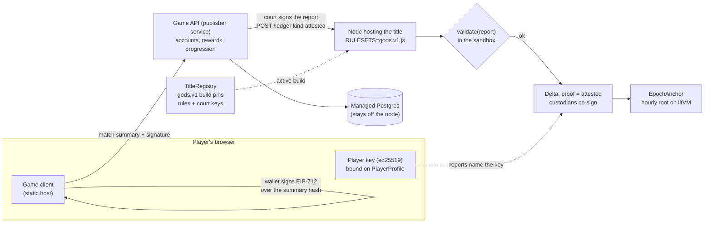

# Step 5: bring your existing game to LitNode

Most games that already run can't be replayed by a stranger's machine. Your engine may use float physics, step on
the wall clock, or keep no input log. For those games LitNode has a second path: the **attested title**. Your
game's own **court** (a key you control) signs each match's outcome report. A node checks the report against your
rules, settles it, labels it `attested`, and puts it under the same hourly root on litVM as every other title.

The worked example is **22 GODS** (https://gods.litvm.games), a real-time strategy game on the Genesys engine with
a Node server and a Postgres database. Its repository is private, so this page describes its architecture and its
steps, with short illustrative snippets only. Checked against LitNode **0.12.1** (protocol 4), the 22 GODS
repository at `3e367b8` and Liteforge (chain 4441) on 2026-11-13.

If your game can be made deterministic, read [04-litnode.md](04-litnode.md) first: the replayable path is the only
one that can produce **official** results.



## Attested or replayable?

LitNode asks four questions:

```bash
cd ../litnode
npm run bridge -- assess --input-log yes|no --deterministic yes|no --engine-open yes|no
```

| Your game | Kind | The node does | The label |
|---|---|---|---|
| Keeps every player's input per tick. Re-running them from the seed reproduces the result on any machine (integer or seeded math, no wall clock, no float physics). The simulation bundles as one import-free module. | **replayable** ([04-litnode.md](04-litnode.md)) | re-runs the log in its sandbox; a witness on another operator's node re-runs it again | `verified` when both players signed: can be **official** |
| Anything else | **attested** | checks your court's signed report against your rules (bounds, win condition, seats) and settles it | `attested`: trusted, not verified, **never official** |

Choose attested when:

- **the engine isn't deterministic across machines.** 22 GODS ticks on a variable frame time, and its physics
  (Rapier) isn't cross-platform deterministic: two runs of the same seed ended at 19:16 and at 7:26;
- **there's no input log** a node could re-run, and adding one is a rewrite;
- **the engine is closed** or can't be bundled into one sandboxed module.

Attested is the honest label for most existing games. The road to replayable stays open (seeded randomness,
integer math, an input log). It is a new build hash, and old results are never relabelled.

There's a middle level. An attested title whose court commits its input log (`report.commitments`, plus the log
bytes) and registers a **verifier bundle** settles as L2 `checkable`, re-runnable by anyone. LitNode's
`docs/SETTLEMENT-STANDARD.md` §11 has the details. 22 GODS keeps no input log yet, so it settles at L1.

## Which steps need your keys

| Step | Key | Whose |
|---|---|---|
| Write, bundle and check the ruleset | none | — |
| Sign every outcome report | the **court key** (ed25519, not a wallet). In 22 GODS it's `COURT_PRIVATE_KEY` in the game server's environment. | **yours**; it lives only with your server |
| `register` / `set-build` the title on TitleRegistry | `PUBLISHER_KEY` (EVM wallet, zkLTC for gas) | **yours**: the title holder |
| Bond the hosting node | `OPERATOR_KEY` (EVM wallet, 1 tLITVM stake) | **yours**: the **same wallet** as the title holder, or the arcade won't list it |
| Bind a player key to a wallet (`PlayerProfile.register` / `bindKey`) | the player's wallet, one transaction | **the player's** |
| Seat challenges, queue entries and match ends in PvP | the player key, held in the browser or the arcade shell | the player's |
| Forge characters in an ERC-6699 registry (optional; 22 GODS mints an actor per wallet) | a minter wallet granted `minter` and `progressor` by the registry admin | yours, plus the registry admin's approval |

Keys go in the server's own environment file, or in the shell for one command. Never put one in the repository,
the node's `node.env` or a service bundle.

## 1. Write the attested ruleset

An attested title is still one import-free file, but it exports rules a node can check without playing:
`validate(report)` returns `null` for a good report or a reason string, `scores(report, participants, teams)` says
who won, and the manifest names the courts that may sign.

```js
import { defineAttestedTitle, winnerTakesCredits } from './vendor/title.js';   // vendored from LitNode's sdk

export default defineAttestedTitle({
  rulesetId: 'my-game.v1',
  modes: ['casual'],                     // PvE against a scripted side can only be casual
  participants: [2], teams: 2,
  attestors: ['<court public key, 64 hex>'],
  services: {
    credits: winnerTakesCredits({ pot: 10, currency: 'glory' }),
    stats: { track: ['matches', 'wins', 'ticks'], schema: { kills: 'sum', fastestWinSeconds: 'min' } },
  },
  display: { title: 'My Game', url: 'https://my-game.example', controls: ['mouse', 'touch'] },
  validate: (report) => (report.outcome === 'victory' || report.outcome === 'defeat' ? null : 'outcome'),
  scores: (report, participants, [teamA, teamB]) => { /* 1 for the winners, 0 for the rest */ },
  stats: (report) => ({ /* per-player counters, from the signed report */ }),
});
```

How 22 GODS fills it in (`server/litnode/gods.v1.mjs`):

- **The report** has the match id, the sha-256 of the match summary, the outcome, the cause (the King's death), the
  chapter, the seconds, the kills, both Gods, the difficulty, and two seats: the player and a `ghost:<god>:<difficulty>`
  seat for the scripted rival. It also carries the EIP-712 hash the player's wallet signed. `validate` checks every
  field's type and bounds, one seat per team, and that team 1 is the ghost.
- **Scores** are 1 to the winning team, 0 to the other. **Credits** pay a pot of 10 `glory` to the winner, the same
  figure the game server pays.
- **Stats** fold `kills` (sum), `chapterWins` (sum) and `fastestWinSeconds` (min) for the human seat only, from
  the report the court signed.
- **The vendored SDK.** LitNode's `title.js`, `canonical.js` and `stats.js` are copied beside the title, so it
  bundles without a LitNode install and the server hashes the same bytes the node does.
- **`attestors`** names the court's public key (`31bdbc4e…0df935`). The list is pinned by the build hash, so every
  node accepts that court with no configuration of its own.

Bundle it with LitNode's tool. 22 GODS runs it **from its own repository root**, so the path comments in the bundle
read `// server/litnode/…`:

```bash
node ../litnode/tools/bundle-title.mjs server/litnode/gods.v1.mjs --out litnode/rulesets
```

This reproduces the committed build exactly: `buildHash 93d90006…b799`, 7,588 bytes. Rebuild only from the same
folder, for the reason in [04-litnode.md](04-litnode.md#why-a-buildhash-changes-when-the-rules-dont). Commit the
artifact as `-text` in `.gitattributes` so line endings can't change its hash.

## 2. The court signs each outcome

The court is an ed25519 identity. For each finished match it signs:

```
'attest' NUL canonical({ matchId, rulesetId, report })
```

`canonical` is JSON with keys sorted recursively, and the key is a raw 32-byte seed. It posts the attested envelope
to a node:

```jsonc
{ "kind": "attested", "matchId": "…", "rulesetId": "gods.v1", "mode": "casual",
  "participants": ["<player key>", "ghost:ares:hard"], "teams": [["<player key>"], ["ghost:ares:hard"]],
  "report": { /* what validate() reads */ },
  "attestor": { "id": "<court public key>", "sig": "<ed25519 signature>" } }
```

You get a court key one of three ways:

- **With LitNode's bridge.**

  ```bash
  npm run bridge -- key --kind attested --ruleset my-game.v1
  ```

  It writes `~/.litnode/bridge-key.json` and prints the `COURTS=` line for an operator.
- **With LitNode's `sdk/court` module**, which builds, signs and posts the envelope, and attaches the v4 log only
  when the node reports protocol 4 or later.
- **With your own code.** 22 GODS signs with Node's built-in Ed25519 in `server/litnode/court.ts`. The seed comes
  from `COURT_PRIVATE_KEY`; without one, the server makes a key on first start and keeps it in a git-ignored file.
  The public half is printed on start.

**What the court vouches for, in 22 GODS.** The court is the progression server, and it **did not watch the
match**. It holds the match summary the client produced, sealed by its sha-256, and the player wallet's EIP-712
signature over that hash. A match without that signature is never reported. So a `gods.v1` result means: "the
wallet that owns this profile signed for this outcome, and the server settled it under its rules". That's the
honest reach of an attested title whose match runs in the player's browser. The PvP match server below (section 7)
changes it, because there the court is the authority that ran the match.

**Reporting.** `server/litnode/mesh.ts` queues each wallet-signed match after the HTTP answer, posts it to
`LITNODE_URL`, retries pending ones on the next sync, and keeps the node's `resultHash` and epoch on the match row.
The authority for gold, XP and unlocks stays the game's own rules module, run on the client and again on the
server. The mesh delta is the public receipt.

## 3. The node validates and settles

For an attested envelope, the node:

1. **Checks the court.** The key must be in the active build's `attestors`, or in the operator's
   `COURTS=<rulesetId>:<pubkey>[,<pubkey>]`. Any other key is refused (`is not an authorized court`).
2. **Runs `validate(report)` and `scores()`** in the same sandbox as a replayable title, and checks seats and mode.
   Ranked needs player keys and a placement. A prefixed id such as `ghost:…` or `gods:<profile>` is allowed for
   casual play only, and it never binds to a profile.
3. **Settles a delta** with `proof: attested`. The `resultHash` commits to the report through
   `finalStateRoot = H('attested', { rulesetId, report })`. Posting the same match id again answers `200` with the
   existing delta (`existing: true`).
4. **Custody.** Three custodian nodes, drawn from the hash of the match id, fetch the delta and co-sign or dispute
   it, attestation-only. Every hour the deltas go under the EpochAnchor root, so 22 GODS' glory is a number under a
   root on litVM, not just a database column.

Check a match from the LitNode checkout:

```bash
npm run bridge -- check <matchId> --node https://<your node>
```

22 GODS' plan expects `settled, not official: casual; court-attested`. The node's
`/credits?ruleset=gods.v1&currency=glory` should match the game's own glory.

## 4. Publisher services: run the backend on the node

A node can supervise your backend's long-lived processes (an accounts API, a matchmaker, lobbies) and publish them
through its own tunnel at `https://<node relay>/svc/<prefix>.<name>/…`, over HTTP and WebSocket. The studio then
hosts only static files. Pickle Brawl's API, matchmaker and courts run this way.

22 GODS' bundle (`litnode/gods.services.json`) is a template you copy outside the repository and edit per machine:

```json
{ "prefix": "gods", "cwd": "<runtime checkout>/server",
  "envFiles": ["<runtime checkout>/server/.env"],
  "portRange": [8830, 8839],
  "services": { "api": { "command": "${node}", "args": ["node_modules/tsx/dist/cli.mjs", "index.ts"],
    "env": { "PORT": "${port}", "HOST": "127.0.0.1", "PUBLIC_URL": "${publicHttp:api}", "LITNODE_URL": "${nodeUrl}" } } } }
```

- **Node configuration:** `SERVICES=<absolute path to the copy>` in `node.env`. Add `GAUNTLET_GATEWAY_PORT=8478`
  when the node already fronts another title's relay on `RELAY_PORT`, then restart. Check that `/svc` lists
  `gods.api` as up.
- **Secrets stay on that machine.** They live in the runtime checkout's `server/.env` (the database URL, the court
  key, the minter key). The node passes them to the service, never to anyone else, and never passes its own
  operator keys.
- **What the service gets for free:**
  - `LITNODE_URL` is the node on loopback, so reports always reach a node;
  - `PUBLIC_URL` follows the tunnel;
  - the node restarts the service on a crash, with backoff, and when the tunnel's hostname changes.
- **The runtime checkout** is a second clone, pinned to the commit the published client was built from. Move the
  client and the server forward together, never one alone.
- **The database stays off the node.** Nodes come and go, and their tunnel hostnames rotate, so a database on the
  node would tie every account to one machine. 22 GODS keeps managed Postgres (Neon), reachable from any node.
- **The client finds the node at runtime**, because a quick tunnel's hostname can't be baked into a build:
  1. read the contract addresses from `arcade.litvm.games/contracts.json`;
  2. read the node's entry from NodeDirectory with `eth_call`;
  3. ask its `/svc` for the API and check the API's health endpoint;
  4. cache the answer.

  22 GODS asks only an allowlist of node keys, because only a node's own announcer writes its entry. Pickle Brawl's
  `web/litnodeBackend.ts` is the pattern, about 150 lines.
- **Static files stay on a static host.** LitNode doesn't host clients. 22 GODS' client is a WebGPU PWA served from
  Vercel at https://gods.litvm.games.

**Status in 22 GODS:** built. The bundle and the client's discovery (`src/progression/meshBackend.ts`) were verified
on a scratch LitNode 0.11.28 node run offline. The production cutover isn't done: the API still runs on its earlier
host, with a planned week of fallback before that host is retired.

## 5. Register the build (`set-build` from the title holder)

The title is the same ERC-721 as in [04-litnode.md](04-litnode.md#3-register-the-title-your-publisher-wallet). A
retune of an attested title (new rules, new court keys, new stats) is a new build under the same id. From the
LitNode checkout, with the **holder's** key in the shell:

```bash
export PUBLISHER_KEY=0x...
npm run publish:title -- set-build ../GODSgame/litnode/rulesets/gods.v1.js
npm run publish:title -- status    ../GODSgame/litnode/rulesets/gods.v1.js
unset PUBLISHER_KEY
```

The build goes active 60 s after it's mined. LitNode 0.12.1's wallet tools still read the dead Caldera RPC, so
change `rpc` in your local `contracts/deployed.testnet.json` to `https://rpc.testnet.liteforge.zeeve.net/` first, or
add `--calldata` and send the transaction from the holder's wallet with a max fee of at least twice the base fee.

**22 GODS on chain, 2026-11-13.** `gods.v1` was registered on 2026-09-21. Its only active build is `373faf6e…`,
which has no `attestors`. The current build, `93d90006…` (LitNode 0.12, court in the manifest, v4 stats), **has not
been set**. Before it is, two things are worth fixing, because each one is a new build:

- `display.url` in `93d90006…` is the placeholder `https://arcade.litvm.games/gods`, while the game is live at
  https://gods.litvm.games. The arcade opens `display.url` in an iframe, so the URL must allow being framed by the
  arcade.
- `display.controls` is a string. The arcade reads only an array and drops a string silently.

Decide the URL, rebuild once, then `set-build` that build.

**The listing rule.** The arcade lists a title only while a node **bonded from the wallet that holds the title**
hosts it. 22 GODS' token and its node's bond are on different wallets today. There are three fixes; bonds are
lock-termed, so it's the owner's call:

1. move the node's bond to the holder wallet (`tools/transfer-operator.mjs`);
2. transfer the `gods.v1` token to the wallet that bonded the node (`npm run publish:title -- transfer`);
3. run a second node bonded from the holder wallet.

## 6. The node's `RULESETS` line

On the node that hosts the title (see [04-litnode.md](04-litnode.md#4-host-it-on-a-node) for `npm run host`):

```ini
RPC=https://rpc.testnet.liteforge.zeeve.net/
RULESETS=C:/gods-runtime/litnode/rulesets/gods.v1.js
SERVICES=C:/node-config/gods.services.json
# Only while the active build has no attestors (373faf6e…):
# COURTS=gods.v1:<court public key>
```

- Keep `gods.v1.json` beside the `.js`.
- An operator's own `RULESETS` load whatever the chain says. But no peer loads the build from you, and no peer
  witnesses it, until it's the title's active build.
- Once a build with `attestors` is active, no node needs a `COURTS` line.
- The hosting node must run protocol 4 (LitNode 0.12.x). `npm run host -- doctor` shows `settlement` true;
  protocol-3 and protocol-4 nodes refuse each other.

Check that `GET https://<node>/titles` shows `gods.v1` with `published: true`.

## 7. Player keys bound to PlayerProfile

The mesh settles players as ed25519 **keys**. A report that names `gods:<profile id>` settles casual and never binds
to a litVM identity. LitNode's model is "the wallet **authorizes** a key; the key **signs**".

PlayerProfile (`0xe2cf46ab11eAfB18c1933409E35ae68CEce88882`, soulbound) holds the binding:

| Call | When |
|---|---|
| `register(bytes32 key, string name)` | first device: mints the profile and binds the key |
| `bindKey(bytes32 key)` | each later device |
| `revokeKey(bytes32 key)` | a lost device; every node refuses the key within a minute |
| `ownerOfKey(bytes32 key)` → `(owner, tokenId, active)` | anyone, to check a binding |

How 22 GODS does it (built 2026-11-06):

- **The browser** makes an ed25519 key per device in WebCrypto and keeps it locally. It signs LitNode's bytes,
  `tag NUL canonical(body)`.
- **One transaction from the signed-in wallet:** `register` on a first device, `bindKey` on a later one, nothing
  when already bound. The max fee is twice the base fee, the Liteforge rule. The Profile panel's "Link this device
  on litVM" runs it.
- **The server** records the key only when the chain says its profile is the wallet the player signed in with.
  From then on its reports name that key, so the delta, the glory and the stats fold into the player's litVM
  profile.
- **Not verified yet:** the transaction itself, which needs a person with a funded wallet in the browser.
- **Inside the arcade** the shell holds the player's key (`cabinet:init`), and the game asks it to sign
  (`cabinet:sign`, `cabinet:sign-seat`), so the key never enters the game. 22 GODS doesn't read the arcade's
  launch parameters yet. That comes with PvP.

## 8. What PvP adds: a match server per match

A PvE match against a scripted side is casual by nature. Ranked needs two player keys and a placement. PvP needs
a server both players trust, and for an engine that can't be replayed, that server must be **the court**: a process
you run, not a player's browser.

LitNode's **gauntlet** runs it. For every match placed on a node with `GAUNTLETS=gods.v1=<config.json>`, the node:

1. spawns your headless server on a free port, with the match in its environment (`GAUNTLET_MATCH_ID`,
   `GAUNTLET_SEATS`, `GAUNTLET_SECRET`, `GAUNTLET_PUBLIC_URL`, `GAUNTLET_NODE_URL`, `GAUNTLET_PLACED_MODE`, …);
2. mints one HMAC seat ticket per player, after the player's key signs a challenge;
3. proxies `wss://<wsAddr>/<room>` to the process;
4. ends the process after the match settles.

At the end, the server signs the attested report **with `matchId` = `GAUNTLET_MATCH_ID` and `mode` =
`GAUNTLET_PLACED_MODE`**, or the node refuses it, and posts it to the node on loopback. The delta then binds to the
placement (`placed: true`). 22 GODS also plans to post the same signed report to its API, which credits both
players under the same rules module. `validate()` gains the PvP shape: two player-key seats and no ghost.

To let **any operator** host matches, ship the server as a **server bundle**: a hashed archive that travels the mesh
like the ruleset.

```bash
npm run bundle:server -- gauntlets/my-game.server.json              # servers/my-game.v1.server.tgz + .json, prints serverHash
npm run publish:title -- set-build servers/my-game.v1.server.json   # the holder registers it under the title
```

Your node serves it with `GAUNTLET_SERVERS=my-game.v1=servers/my-game.v1.server.tgz`. Other operators opt in with
`GAUNTLET_SERVERS=my-game.v1`, with no checkout. A bundle can't carry a machine-local court key: the server generates
one in `GAUNTLET_STATE_DIR` on first run, and each operator's court key goes into `attestors` (a new build) or that
operator's `COURTS`.

**22 GODS' PvP status (its Phase 4): mostly not built.**

- **4.0, the go/no-go spike: GO** (2026-10-19). The built game runs headless in Node as the engine's
  `DedicatedServer`. In a 20-match God matrix at seed 1:
  - all 20 matches ended with a King's death;
  - median speed was 7.5× real time on about one core;
  - peak memory was 522–827 MB.
- **Parity:** a West-seat gap against the in-browser run was traced to titans on the server and fixed
  (2026-10-23).
- **Not built:**
  - 4.1, server authority and replication;
  - 4.2, seat-aware controllers and commands as server RPCs;
  - 4.3, the gauntlet config and the server as court;
  - matchmaking and ranks (Phase 5);
  - the server bundle for other operators (Phase 6).
- **Known issue for 4.1:** in a real network session the engine makes a player-possessed pawn an autonomous proxy,
  which would stop the God's order-driven walk.

**Ranked still needs four operators.** A match goes on chain only with a host and three witnesses under four
different operators. With fewer, it plays and ranks on the `scope=all` ladder but never reaches MatchBook. And an
attested title is never official, ranked or not.

## Checklist

1. `bridge -- assess` says attested, and you've written down why (engine, physics, no log).
2. An attested ruleset with `validate`, `scores`, `attestors`, `display` and stats. It passes conformance and is
   bundled from a fixed folder, committed as `-text`.
3. A court key in your server's own environment. Reports are signed and posted, with retry and idempotency.
4. The holder wallet runs `register` or `set-build` on that exact file. `status` shows it `active`.
5. A node bonded from the **same** wallet hosts it (`RULESETS`, optionally `SERVICES`, `RPC=<Zeeve>`), and
   `/titles` shows `published: true`.
6. Players bind their keys on PlayerProfile, and reports name keys, not database ids.
7. One real match settles: `bridge -- check <matchId>` shows `attested`, and the node's credits match yours.

## Still open (2026-11-13)

- **22 GODS' wallet-signed steps**, all waiting on the owner's wallets:
  - the listing fix (title holder ≠ the node's bonding wallet);
  - `set-build` of the current build;
  - the node's `RULESETS` (and `SERVICES`) lines;
  - the minter roles for its ERC-6699 actors.
- **22 GODS' `display.url`** still names a placeholder, so the build to register needs one more rebuild.
- **22 GODS' PvP** (Phase 4.1–4.3) and everything after it are not built.
- **The player-key transaction** is built but not yet run with a real funded wallet.
- **22 GODS forges its actors into LitNode's ERC-6699 registry** (`0x38DF…`). If LitNode moves to the Rapture
  registry, the fix [04-litnode.md](04-litnode.md#8-champions-the-erc-6699-registry-the-node-reads) recommends,
  22 GODS' minter must move with it, and the new registry's admin must grant it `minter` and `progressor`.
- **LitNode 0.12.1's wallet tools still name the dead Caldera RPC**; see
  [04-litnode.md](04-litnode.md#0-before-you-start).
- **The court vouches for the client's summary**, not a match it watched, until a PvP server or an input log changes
  that. The UI should say "attested", not "verified".
